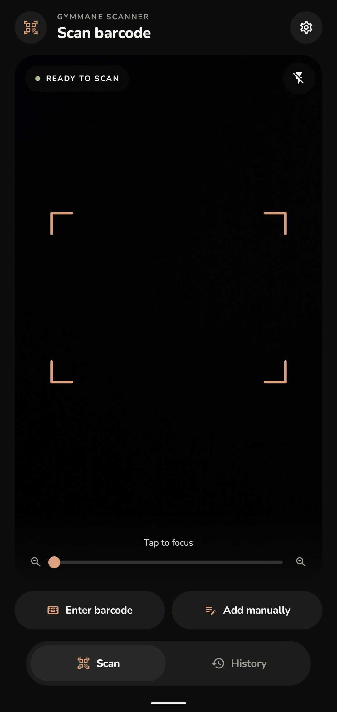
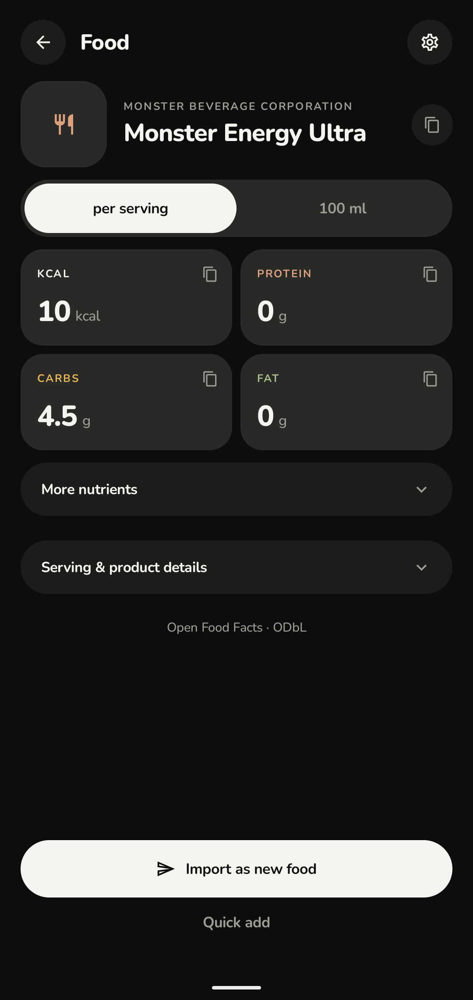
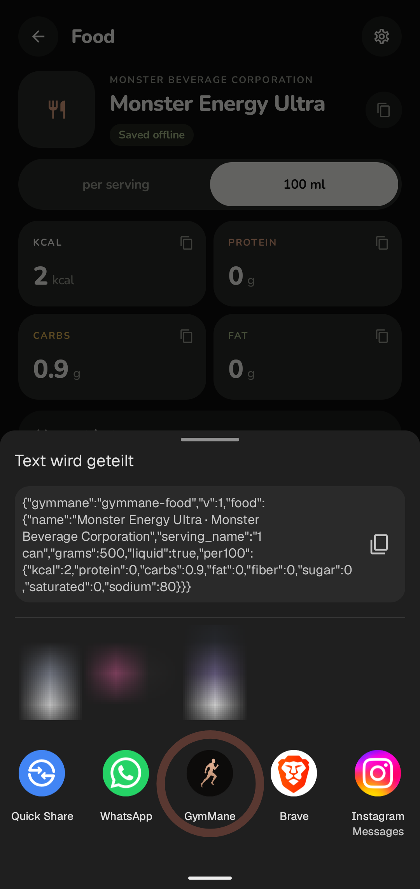
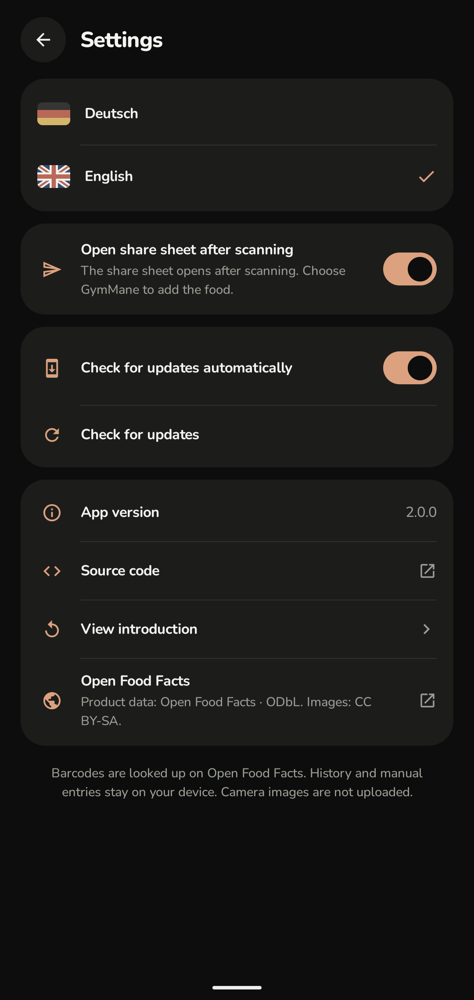
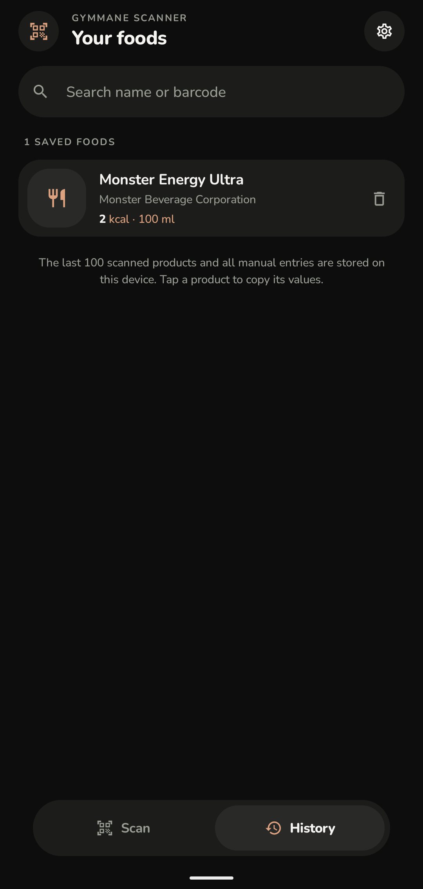

# 📷 GymMane-Scanner
Food barcode scanner app for GymMane. Scans product barcodes, retrieves nutritional data, and imports them directly into GymMane as new food entries.

---

**Scan a barcode. Get the nutrition facts. Send them straight to your calorie tracker.**

GymMane Scanner is a tiny Android app that turns the barcode on any food package into a ready-to-use food entry. No typing, no searching, no copying numbers by hand.

> **Heads up:** This is an independent, self-developed project. It is **not affiliated with, endorsed by, or connected to [GymMane](https://github.com/InlitX/GymMane)** in any way. It simply produces food data in a format GymMane can read.

---

## ✨ Why you'll like it

- 🔒 **Fully offline-friendly and private**: no account, no sign-up, no tracking: it only uses Internet connection for checking for updates and searching up the barcode in the open food facts database anonymously
- 🚫 **No trackers, no ads**
- ⚡ **Fast**: scan, check, send
- 🪶 **Simple**: it does one thing and does it well

---

## 📸 Screenshots

| Scan | Product | Import to GymMane | Settings | Scan history |
|:---:|:---:|:---:|:---:|:---:|
|  |  |  |  | 

---

## 🚀 How it works

1. **Scan** the barcode on your food.
2. **Create the food**: the app builds a complete entry with all nutrition values.
3. **Send it to GymMane**. Tap „Send to GymMane“ and select GymMane in the opening android share dialog
4. That's it. GymMane opens with the food already filled in, ready to save.

---

## 📲 Installation

1. Go to the [**Releases**](../../releases) page and download the latest `.apk` file.
2. Open the file on your Android phone.
3. If asked, allow installing apps from this source.
4. Open the app and start scanning.

5. **Please make sure to have GymMane v2.4 or newer installed, otherwise it wont work here :(**

---

## ℹ️ Good to know

- Android only.
- Nutrition data depends on what is available for each product. If something looks off, double-check it against the package before saving.
- This is a hobby project, built for my own needs and shared in case it helps someone else.
- The app uses the [Nunito](https://github.com/googlefonts/nunito) font (SIL Open Font License 1.1).

---

## 💬 Feedback

Found a bug or have an idea? Open an [issue](../../issues). I'm happy to hear from you.

---

## ⚠️ Warning

Google PlayProtect is currently still warning before installing the app or updates. No worries: there is no virus in it  
If you feel unsafe visit [VirusTotal Scan](https://www.virustotal.com/gui/url/d3941defa825daecf457eb560d3721394997744f0f1b921d1ded4ad7651be2bf?nocache=1)  
I already contacted Google about this and the problem will be solved soon

